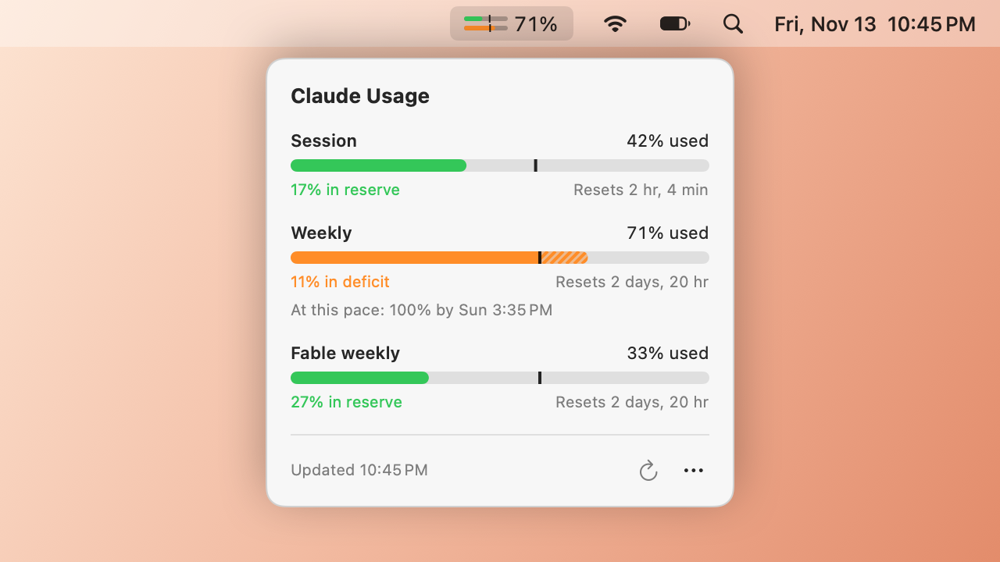

<div align="center">

# ClaudeBar

**Your Claude usage, one glance away in the macOS menu bar.**


<picture>
  <source media="(prefers-color-scheme: dark)" srcset="docs/hero-dark.png">
  
</picture>

</div>

## What it shows

The menu bar shows two mini bars, your 5-hour **session** usage on top and your **weekly** usage below, followed by your weekly percentage. Each bar is coloured by pace and has a tick where an even pace would put you. Click it to open the panel, which shows each limit:

| Limit | Window | Notes |
| --- | --- | --- |
| **Session** | 5 hours | Shows "No active session" when idle |
| **Weekly** | 7 days | Across all models |
| **Fable weekly** | 7 days | Only appears if your plan has a Fable-specific limit |

Each limit has a usage bar, a countdown to its reset, and your **pace**.

## Pacing

ClaudeBar compares your usage against an even burn rate across the window. The tick on each bar marks where that even pace would put you right now.

- **In reserve** (green): you're under pace. If 40% of the week has passed and you've used 30%, you're **10% in reserve**.
- **In deficit** (red): you're over pace. Used 50% at the same point? You're **10% in deficit**.

Bars and pace text are **green** under pace, **orange** over pace and **red** above 90%. Usage past the tick is hatched, so you can see how far over you are. When you're over pace, the panel also says when you'd hit 100% at your current rate. That line only appears once 10% of the window has passed. Hover a reset countdown to see the exact reset time.

## Getting started

### Requirements

- macOS 13 or later
- A Swift toolchain. The Command Line Tools are enough; you don't need Xcode.
- A logged-in Claude Code (`claude`). ClaudeBar reads the same OAuth token from the `Claude Code-credentials` keychain item.

### Build & run

```sh
./build.sh
open build/ClaudeBar.app
```

> [!TIP]
> To launch it at login, copy `build/ClaudeBar.app` to `/Applications`, open it from there, and turn on **Launch at Login** in the panel's ⋯ menu.

## How it works

- Usage comes from `https://api.anthropic.com/api/oauth/usage`, the same endpoint Claude Code's `/usage` command calls.
- It refreshes every 5 minutes, or when you click ↻. The token is read again on every refresh, so tokens Claude Code refreshes get picked up.
- If it says your token expired, run `claude` once to refresh it.

> [!WARNING]
> The usage endpoint is undocumented and may change without notice.
